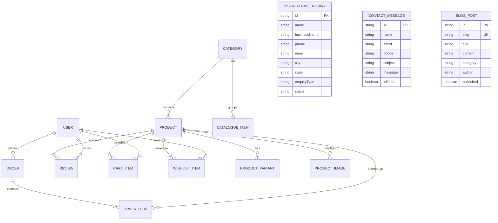

# Vishvnath Traders — Backend Architecture, Database Schema & API Specification

**Project:** Vishvnath Traders (Plywood & Timber E-Commerce / B2B Portal)  
**Author:** Engineering Team  
**Document Version:** 1.0  
**Target Audience:** Technical Leadership, Boss, & Development Team  

---

## 1. Executive Summary & Recommended Tech Stack

The Vishvnath Traders frontend is currently built using **Next.js 16 (App Router)**, **React 19**, and **TypeScript**, serving a mixed B2C (retail buyers, interior designers) and B2B (distributors, dealers, bulk commercial contractors) audience.

### Recommended Architecture: Next.js Full-Stack + Prisma ORM + PostgreSQL

| Layer | Recommended Technology | Why This Choice? |
| :--- | :--- | :--- |
| **Backend Runtime** | **Next.js Route Handlers** (`app/api/*`) or Dedicated Node.js (**Express / NestJS**) | Eliminates CORS issues, shares TypeScript models directly with `src/types/index.ts`, runs serverless or on Docker. |
| **Database** | **PostgreSQL** (hosted on Supabase, Neon, or AWS RDS) | Relational integrity for orders, users, and transactions; **JSONB** support for dynamic plywood product specifications. |
| **ORM / Data Access** | **Prisma ORM** | Type-safe queries, automatic migrations, zero boilerplate, auto-generated TypeScript client. |
| **Authentication** | **JWT (HTTP-only cookies)** or **NextAuth.js / Auth.js** | Secure session management supporting Email/Password and Google OAuth. |
| **Validation** | **Zod** | Runtime request body validation aligned with existing TypeScript interfaces. |
| **Media Storage** | **Cloudinary** or **AWS S3** | Optimized image storage, automatic WebP conversion, fast CDN delivery for product & catalogue photos. |
| **Notifications** | **Resend** / **Nodemailer** + **WhatsApp Business API (Twilio / Gupshup)** | Instant notifications to management when distributor or bulk inquiry is received. |

---

## 2. Entity Relationship Diagram (ERD)



---

## 3. Complete Database Schema (Prisma ORM / PostgreSQL)

Save this file as `prisma/schema.prisma`:

```prisma
datasource db {
  provider = "postgresql"
  url      = env("DATABASE_URL")
}

generator client {
  provider = "prisma-client-js"
}

// -----------------------------------------------------------------------------
// ENUMS
// -----------------------------------------------------------------------------

enum Role {
  CUSTOMER
  DEALER
  DISTRIBUTOR
  ADMIN
}

enum EnquiryType {
  DISTRIBUTOR
  DEALER
  BULK_ORDER
  OTHER
}

enum EnquiryStatus {
  PENDING
  REVIEWED
  CONTACTED
  APPROVED
  REJECTED
}

enum OrderStatus {
  PENDING_QUOTE
  CONFIRMED
  PROCESSING
  SHIPPED
  DELIVERED
  CANCELLED
}

enum PaymentStatus {
  UNPAID
  PARTIALLY_PAID
  PAID
  REFUNDED
}

// -----------------------------------------------------------------------------
// USERS & AUTHENTICATION
// -----------------------------------------------------------------------------

model User {
  id            String    @id @default(uuid())
  name          String
  email         String    @unique
  passwordHash  String?
  phone         String?
  role          Role      @default(CUSTOMER)
  businessName  String?
  gstNumber     String?
  address       String?
  city          String?
  state         String?
  pincode       String?
  emailVerified DateTime?
  image         String?
  createdAt     DateTime  @default(now())
  updatedAt     DateTime  @updatedAt

  reviews       Review[]
  orders        Order[]
  cartItems     CartItem[]
  wishlistItems WishlistItem[]

  @@index([email])
}

// -----------------------------------------------------------------------------
// CATEGORIES & CATALOGUE
// -----------------------------------------------------------------------------

model Category {
  id            String          @id @default(uuid())
  slug          String          @unique
  name          String
  description   String?
  image         String?
  subcategories String[]        @default([])
  createdAt     DateTime        @default(now())
  updatedAt     DateTime        @updatedAt

  products       Product[]
  catalogueItems CatalogueItem[]

  @@index([slug])
}

// -----------------------------------------------------------------------------
// PRODUCTS & VARIANTS
// -----------------------------------------------------------------------------

model Product {
  id               String           @id @default(uuid())
  slug             String           @unique
  name             String
  brand            String?          @default("Vishvnath Traders")
  categoryId       String
  category         Category         @relation(fields: [categoryId], references: [id], onDelete: Cascade)
  
  price            Float            // Base selling price in INR
  mrp              Float            // MRP for strikethrough comparison
  pricePerSqFt     Float?
  inStock          Boolean          @default(true)
  featured         Boolean          @default(false)
  warranty         String?          @default("15 Years")

  shortDescription String
  description      String           @db.Text
  
  // Dynamic plywood/hardware specs stored as structured JSON:
  // e.g. { "IS Standard": "IS:303", "Glue Type": "Phenol Formaldehyde", "Core Material": "Hardwood Core" }
  specifications   Json?
  
  // Available attributes & badges
  thicknessList    String[]         @default([]) // e.g. ["6mm", "9mm", "12mm", "18mm"]
  sizesList        String[]         @default([]) // e.g. ["8x4 ft", "7x4 ft"]
  useCases         String[]         @default([]) // e.g. ["Kitchen Cabinets", "Wardrobes"]
  benefits         Json?            // Array of { icon: string, title: string, description: string }
  faqs             Json?            // Array of { question: string, answer: string }
  tags             String[]         @default([])

  createdAt        DateTime         @default(now())
  updatedAt        DateTime         @updatedAt

  images           ProductImage[]
  variants         ProductVariant[]
  reviews          Review[]
  cartItems        CartItem[]
  wishlistItems    WishlistItem[]
  orderItems       OrderItem[]

  @@index([slug])
  @@index([categoryId])
}

model ProductImage {
  id        String   @id @default(uuid())
  productId String
  product   Product  @relation(fields: [productId], references: [id], onDelete: Cascade)
  url       String
  alt       String?
  isPrimary Boolean  @default(false)
  sortOrder Int      @default(0)

  @@index([productId])
}

model ProductVariant {
  id        String      @id @default(uuid())
  productId String
  product   Product     @relation(fields: [productId], references: [id], onDelete: Cascade)
  thickness String?     // e.g. "18mm"
  size      String?     // e.g. "8x4 ft"
  price     Float       // Variant-specific price
  mrp       Float?
  sku       String?     @unique
  stock     Int         @default(100)

  cartItems  CartItem[]
  orderItems OrderItem[]

  @@unique([productId, thickness, size])
  @@index([productId])
}

// -----------------------------------------------------------------------------
// VISUAL CATALOGUE (Doors, Louvers, Sheets, Laminates)
// -----------------------------------------------------------------------------

model CatalogueItem {
  id          String    @id @default(uuid())
  slug        String    @unique
  name        String
  categoryId  String
  category    Category  @relation(fields: [categoryId], references: [id], onDelete: Cascade)
  subcategory String?
  type        String?   // e.g. "WPC", "PVC"
  brand       String?
  productLine String?
  sizes       String[]  @default([])
  thickness   String[]  @default([])
  images      String[]  @default([])
  description String?   @db.Text
  createdAt   DateTime  @default(now())
  updatedAt   DateTime  @updatedAt

  @@index([categoryId])
  @@index([slug])
}

// -----------------------------------------------------------------------------
// REVIEWS & RATINGS
// -----------------------------------------------------------------------------

model Review {
  id        String   @id @default(uuid())
  productId String
  product   Product  @relation(fields: [productId], references: [id], onDelete: Cascade)
  userId    String?
  user      User?    @relation(fields: [userId], references: [id], onDelete: SetNull)
  name      String
  rating    Int      // 1 to 5
  comment   String   @db.Text
  location  String?
  isApproved Boolean @default(true)
  createdAt DateTime @default(now())

  @@index([productId])
}

// -----------------------------------------------------------------------------
// SHOPPING CART & WISHLIST
// -----------------------------------------------------------------------------

model CartItem {
  id        String          @id @default(uuid())
  userId    String?
  user      User?           @relation(fields: [userId], references: [id], onDelete: Cascade)
  sessionId String?         // For guest carts before login
  productId String
  product   Product         @relation(fields: [productId], references: [id], onDelete: Cascade)
  variantId String?
  variant   ProductVariant? @relation(fields: [variantId], references: [id], onDelete: SetNull)
  thickness String?
  size      String?
  quantity  Int             @default(1)
  createdAt DateTime        @default(now())
  updatedAt DateTime        @updatedAt

  @@unique([sessionId, productId, thickness, size])
  @@index([userId])
  @@index([sessionId])
}

model WishlistItem {
  id        String   @id @default(uuid())
  userId    String?
  user      User?    @relation(fields: [userId], references: [id], onDelete: Cascade)
  sessionId String?
  productId String
  product   Product  @relation(fields: [productId], references: [id], onDelete: Cascade)
  createdAt DateTime @default(now())

  @@unique([userId, productId])
  @@index([userId])
}

// -----------------------------------------------------------------------------
// ORDERS & RFQ (REQUEST FOR QUOTATION)
// -----------------------------------------------------------------------------

model Order {
  id             String        @id @default(uuid())
  orderNumber    String        @unique // e.g. VT-2026-1001
  userId         String?
  user           User?         @relation(fields: [userId], references: [id], onDelete: SetNull)
  
  customerName   String
  customerEmail  String
  customerPhone  String
  shippingAddress String       @db.Text
  city           String
  state          String
  pincode        String
  gstNumber      String?
  notes          String?       @db.Text
  
  subtotal       Float
  taxAmount      Float         @default(0)
  shippingFee    Float         @default(0)
  totalAmount    Float
  
  status         OrderStatus   @default(PENDING_QUOTE)
  paymentStatus  PaymentStatus @default(UNPAID)
  paymentMethod  String?       // "RAZORPAY", "BANK_TRANSFER", "COD", "CREDIT"
  paymentId      String?
  
  createdAt      DateTime      @default(now())
  updatedAt      DateTime      @updatedAt

  items          OrderItem[]

  @@index([orderNumber])
  @@index([userId])
}

model OrderItem {
  id          String          @id @default(uuid())
  orderId     String
  order       Order           @relation(fields: [orderId], references: [id], onDelete: Cascade)
  productId   String
  product     Product         @relation(fields: [productId], references: [id])
  variantId   String?
  variant     ProductVariant? @relation(fields: [variantId], references: [id])
  productName String
  thickness   String?
  size        String?
  unitPrice   Float
  quantity    Int
  totalPrice  Float

  @@index([orderId])
}

// -----------------------------------------------------------------------------
// B2B DISTRIBUTOR / DEALER ENQUIRIES
// -----------------------------------------------------------------------------

model DistributorEnquiry {
  id           String        @id @default(uuid())
  name         String
  businessName String
  phone        String
  email        String
  city         String
  state        String
  enquiryType  EnquiryType   @default(DISTRIBUTOR)
  message      String        @db.Text
  status       EnquiryStatus @default(PENDING)
  adminNotes   String?       @db.Text
  createdAt    DateTime      @default(now())
  updatedAt    DateTime      @updatedAt

  @@index([status])
  @@index([state])
}

// -----------------------------------------------------------------------------
// GENERAL CONTACT INQUIRIES
// -----------------------------------------------------------------------------

model ContactMessage {
  id        String   @id @default(uuid())
  name      String
  email     String
  phone     String
  subject   String
  message   String   @db.Text
  isRead    Boolean  @default(false)
  createdAt DateTime @default(now())

  @@index([isRead])
}

// -----------------------------------------------------------------------------
// CONTENT: BLOGS & TESTIMONIALS
// -----------------------------------------------------------------------------

model BlogPost {
  id         String   @id @default(uuid())
  slug       String   @unique
  title      String
  excerpt    String   @db.Text
  content    String   @db.Text
  category   String
  author     String
  authorRole String
  date       DateTime @default(now())
  coverImage String
  readTime   Int      @default(5)
  tags       String[] @default([])
  published  Boolean  @default(true)
  createdAt  DateTime @default(now())
  updatedAt  DateTime @updatedAt

  @@index([slug])
  @@index([category])
}

model Testimonial {
  id         String   @id @default(uuid())
  name       String
  role       String
  company    String
  message    String   @db.Text
  rating     Int      @default(5)
  avatar     String?
  isFeatured Boolean  @default(true)
  createdAt  DateTime @default(now())
}
```

---

## 4. RESTful API Specification

### Base URL: `/api`

### 4.1 Authentication & Profile (`/api/auth`)

| Method | Endpoint | Description | Auth Required |
| :--- | :--- | :--- | :--- |
| `POST` | `/api/auth/register` | Register new user / dealer | Public |
| `POST` | `/api/auth/login` | Login with email & password (returns JWT / sets cookie) | Public |
| `POST` | `/api/auth/logout` | Clear auth cookie | Public |
| `GET` | `/api/auth/me` | Fetch currently logged-in user profile | `Bearer / Cookie` |
| `POST` | `/api/auth/forgot-password` | Send password reset link / OTP | Public |
| `POST` | `/api/auth/reset-password` | Set new password via token | Public |

---

### 4.2 Products & Categories (`/api/products`, `/api/categories`)

| Method | Endpoint | Description | Auth Required |
| :--- | :--- | :--- | :--- |
| `GET` | `/api/categories` | List all product categories | Public |
| `GET` | `/api/categories/:slug` | Category details with subcategories | Public |
| `GET` | `/api/products` | Filtered & paginated product catalog | Public |
| `GET` | `/api/products/:slug` | Single product details with specs, FAQs, reviews | Public |
| `GET` | `/api/catalogue` | Visual catalogue products (Doors, Louvers, etc.) | Public |
| `POST` | `/api/admin/products` | Create product | `Admin only` |
| `PUT` | `/api/admin/products/:id` | Update product | `Admin only` |
| `DELETE` | `/api/admin/products/:id` | Delete / archive product | `Admin only` |

---

### 4.3 Shopping Cart & Wishlist (`/api/cart`, `/api/wishlist`)

| Method | Endpoint | Description | Auth Required |
| :--- | :--- | :--- | :--- |
| `GET` | `/api/cart` | Get current user's or guest's cart items | Public / Optional Auth |
| `POST` | `/api/cart/items` | Add product to cart | Public / Optional Auth |
| `PATCH` | `/api/cart/items/:id` | Update quantity | Public / Optional Auth |
| `DELETE` | `/api/cart/items/:id` | Remove item from cart | Public / Optional Auth |
| `DELETE` | `/api/cart` | Clear entire cart | Public / Optional Auth |
| `GET` | `/api/wishlist` | Get user's saved wishlist | `User only` |
| `POST` | `/api/wishlist/toggle` | Add/Remove product from wishlist | `User only` |

---

### 4.4 Inquiries & Lead Generation (`/api/enquiries`, `/api/contact`)

| Method | Endpoint | Description | Auth Required |
| :--- | :--- | :--- | :--- |
| `POST` | `/api/enquiries/distributor` | Submit dealer/distributor partnership inquiry | Public |
| `POST` | `/api/contact` | Submit contact us message | Public |
| `GET` | `/api/admin/enquiries` | View all distributor inquiries (with filters by state/status) | `Admin only` |
| `PATCH` | `/api/admin/enquiries/:id` | Update inquiry status (`REVIEWED`, `CONTACTED`, etc.) | `Admin only` |
| `GET` | `/api/admin/contact-messages` | View contact form messages | `Admin only` |

---

### 4.5 Orders, Quotes & Checkout (`/api/orders`)

| Method | Endpoint | Description | Auth Required |
| :--- | :--- | :--- | :--- |
| `POST` | `/api/orders` | Create an Order or Request for Quote (RFQ) | Public / User |
| `GET` | `/api/orders/:orderNumber` | Get order status and invoice details | Public / User |
| `GET` | `/api/user/orders` | Get all past orders for logged in user | `User only` |
| `POST` | `/api/checkout/create-payment-intent` | Initialize Razorpay / Stripe payment gateway | Public / User |
| `POST` | `/api/checkout/verify-payment` | Verify Razorpay webhook/signature | Public |

---

### 4.6 Blogs, Testimonials & Public Content

| Method | Endpoint | Description | Auth Required |
| :--- | :--- | :--- | :--- |
| `GET` | `/api/blogs` | Get published blog posts | Public |
| `GET` | `/api/blogs/:slug` | Get single blog post by slug | Public |
| `GET` | `/api/testimonials` | Get customer & designer reviews | Public |
| `POST` | `/api/products/:id/reviews` | Submit product review | `User / Verified` |

---

## 5. Backend Implementation Roadmap

### Phase 1: Foundation (1 – 2 Weeks)
1. Setup PostgreSQL database (e.g. Supabase, Neon, or AWS RDS).
2. Install Prisma ORM (`prisma`, `@prisma/client`) and execute initial migration.
3. Seed existing static mock data from `src/data/*` directly into PostgreSQL.
4. Implement `POST /api/enquiries/distributor` and `POST /api/contact` with email alerts (Resend/Nodemailer).

### Phase 2: Catalog & Auth APIs (1 – 2 Weeks)
1. Implement dynamic catalog APIs (`GET /api/products`, `GET /api/products/[slug]`, `GET /api/catalogue`).
2. Implement Authentication via JWT or NextAuth.js.
3. Connect frontend `AuthModal.tsx` and `distributor/page.tsx` with live APIs.

### Phase 3: Cart, Quotations & Payment (2 Weeks)
1. Synchronize guest localStorage cart with server database on login.
2. Implement Request for Quote (RFQ) & Razorpay checkout integration.
3. Build internal admin dashboard for product management & lead tracking.
